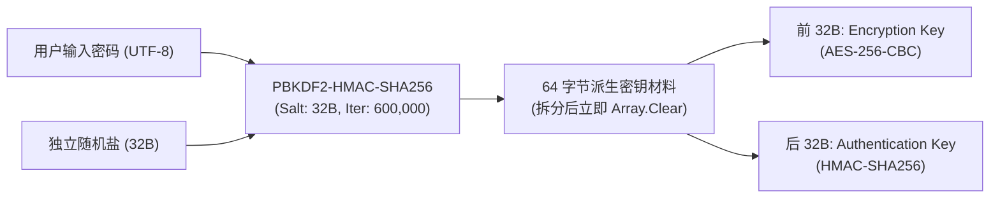
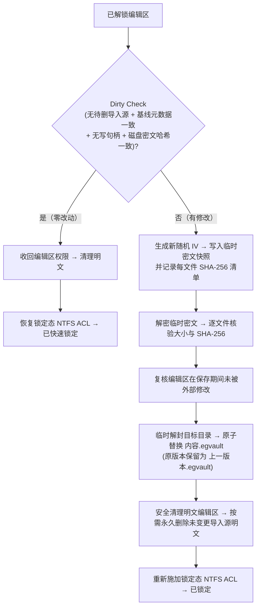

# 密封夹（FolderSeal）安全架构白皮书

> **适用版本**：密封夹（FolderSeal）v2.14.0 及后续同格式版本（密文格式标识 `EGFOLD01`）  
> **定位说明**：本文面向安全研究人员、技术审计者与高级用户，完整披露密封夹的威胁模型、密文二进制格式、密钥生命周期、故障安全状态机、Windows NTFS ACL 权限矩阵及更新供应链安全机制。日常使用边界请同时阅读 [安全边界](安全边界.md)。

---

## 1. 设计原则与威胁模型

密封夹的设计目标是：**在不安装任何内核驱动或虚拟磁盘驱动（如 WinFsp / Dokan）的前提下，在 Windows 10/11 本机 NTFS 磁盘上提供密码学机密性、完整性保护与同账户进程级防窥/防误删能力。**

### 1.1 防护目标（In-Scope Threats）

| 威胁场景 | 防护机制 |
| :--- | :--- |
| **脱机磁盘窃取 / 密文副本泄露** | 所有文件内容、文件名与目录结构打包后经 `AES-256-CBC` 加密与 `HMAC-SHA256` 认证，密钥由 `PBKDF2-HMAC-SHA256`（600,000 次迭代 + 32 字节随机盐）派生。 |
| **密文篡改 / 截断 / 填充预言攻击** | 严格遵循 **Encrypt-then-MAC**：先对完整文件头与密文做 `HMAC-SHA256` 常时间校验，认证失败前绝不执行 AES 解密。 |
| **同账户普通进程与本地 AI Agent 窥探** | 锁定态通过 NTFS ACL 剥夺当前普通用户的读取、列出、修改、删除权限，未解锁时普通权限软件、索引器及本地 AI 工具无法读取或枚举密文目录。 |
| **普通用户、管理员常规程序与 SYSTEM 服务误删/篡改** | 锁定态对密文目录、密文文件及 `.lnk` 入口施加 `User` / `Administrators` / `SYSTEM` 的显式 `Deny Write \| Delete`（目录含 `DeleteSubdirectoriesAndFiles`），并收紧管理员与 `SYSTEM` 允许位。 |
| **保存中断、断电、崩溃导致资料损坏** | 保存前先解密新密文并逐文件核对 SHA-256；保留 `上一版本.egvault`；改密采用加密流转换与加密事务日志；异常退出工作区可识别并安全恢复。 |
| **归档路径穿越 / 符号链接攻击** | 解压前全量校验归档路径，拒绝重复文件名、相对路径穿越、Unix 符号链接标记（`0xA000`）以及 NTFS 重解析点/硬链接。 |

### 1.2 明确不防护的边界（Out-of-Scope / Non-Goals）

- **解锁期间的明文暴露**：解锁后明文位于当前用户可写的临时编辑区，同一 Windows 账户下的其他程序在解锁期间可访问这些文件。
- **已获得管理员/内核权限的恶意攻击者**：管理员仍可通过 `icacls /remove:d` 解除拒绝规则、接管所有权、加载内核驱动或脱机格式化磁盘来破坏或删除密文（但仍无法在不知密码的情况下解密）。
- **物理磁盘痕迹与托管内存残留**：明文清理采用普通文件删除，不承诺清除 SSD 闪存历史块、编辑器缓存或 .NET 托管堆中的全部内存副本。
- **弱密码离线暴力破解**：首次设置密码最低门槛为 8 个字符；弱密码仍面临离线猜测风险。
- **忘密找回**：程序无后门、无云端密钥托管，**忘记密码无法恢复数据**。

---

## 2. 密文二进制格式规范（`EGFOLD01`）

无论是文件夹快照（`内容.egvault`、`上一版本.egvault`）还是本地加密目录表（`catalog.egcatalog`）与改密事务记录（`SecretRecord`），均采用统一的 **Encrypt-then-MAC** 二进制格式。任何第三方均可在不依赖密封夹程序的情况下，按本规范独立实现校验器或解密器。

### 2.1 字节布局表

| 字节偏移 | 长度（字节） | 字段名 | 编码与约束 |
| :--- | :--- | :--- | :--- |
| `0 .. 7` | 8 | `Magic` | 固定 ASCII 字符串 `"EGFOLD01"`（`45 47 46 4F 4C 44 30 31`） |
| `8 .. 11` | 4 | `Iterations` | 小端序 `Int32`，PBKDF2 迭代次数；新建默认 `600,000`，读取允许范围 `[100,000, 2,000,000]` |
| `12 .. 43` | 32 | `Salt` | 密码学安全随机数（`RandomNumberGenerator.Create()`），每个密文文件独立生成 |
| `44 .. 59` | 16 | `IV` | 密码学安全随机初始化向量，每次保存均重新生成 |
| `60 .. L-33` | `>= 16`（16 的倍数） | `Ciphertext` | `AES-256-CBC` + `PKCS#7` 填充密文；`.egvault` 明文为 UTF-8 编码的 ZIP 归档，`SecretRecord` 明文为 UTF-8 结构化记录 |
| `L-32 .. L-1` | 32 | `HMAC` | `HMAC-SHA256(AuthenticationKey, Bytes[0 .. L-33])`，完整覆盖 60 字节文件头与全部密文 |

> 最小合法文件长度：`60 (Header) + 16 (最小密文块) + 32 (HMAC) = 108` 字节（源码校验 `stream.Length >= Header.Size + 48` 且 `(stream.Length - Header.Size - 32) % 16 == 0`）。

### 2.2 认证与解密流程

1. 校验目标路径不含符号链接/联接点（`Paths.NoLinks`），校验文件长度与魔数 `"EGFOLD01"` 及迭代次数范围。
2. 通过 `KeySet` 派生 32 字节加密密钥与 32 字节认证密钥。
3. 使用 `LimitedStream` 仅读取 `[0 .. L-33]` 计算 `HMAC-SHA256`，与末尾 32 字节执行**常时间比对**（`Paths.Equal`）；若不匹配立即抛出 `CryptographicException`，不触发任何解密。
4. 认证通过后，从同一打开的文件流偏移 `44` 重新读取 16 字节 IV 并与已解析的 `Header.IV` 做常时间比对，防止文件头在读取与认证之间发生 TOCTOU 替换。
5. 以 `AES-256-CBC`（`PKCS#7`）解密 `[60 .. L-33]`；若为 `.egvault` 快照，解压前逐条校验 ZIP 条目：拒绝重复路径、非法路径穿越及 Unix 符号链接属性（`(ExternalAttributes >> 16) & 0xF000 == 0xA000`）。

---

## 3. 密钥体系与内存生命周期

- **密钥隔离**：加密密钥与认证密钥严格分离，不复用同一密钥做加密与 MAC。
- **统一密码 + 独立随机盐**：所有新建与已接入目录共用同一用户密码，但每个加密目录及其每次改密均使用独立的 32 字节随机盐，确保相同明文在不同目录中产生完全不同的密文。
- **最小驻留原则**：
  - 密码仅用于当前访问验证或改密操作，完成后释放密码引用与内存中的明文目录表；
  - 解锁会话仅持有当前活动目录的 `KeySet`，在密文提交并完成清理记录后调用 `KeySet.Dispose()` 对 `Encryption` 与 `Authentication` 字节数组执行 `Array.Clear`；
  - 可选的“密码提示”（最多 100 字符，校验禁止包含密码本身）以明文存储在 `%LOCALAPPDATA%\EurekaGao\FolderSeal\settings.txt`，不参与任何加密运算。

---

## 4. 故障安全与原子事务状态机

### 4.1 保存并锁定（含零改动秒锁 `R-049`）

- 若保存阶段任意一步失败，原 `内容.egvault` 与用户编辑区均完整保留，并恢复编辑权限供用户排查重试。
- 若密文已原子提交但明文清理被外部进程占用中断，状态转为“待清理”，重试时只执行清理与重封锁，避免用残缺编辑区覆盖已提交的新密文。

### 4.2 流式批量改密（`R-046`）

- 改密过程**不将任何明文解压到磁盘**：直接在流级别完成旧密钥认证解密 → 新盐新 IV 重加密 → 新密钥复核认证 → 逐文件原子替换（同时迁移 `内容.egvault` 与 `上一版本.egvault`）。
- 事务状态写入加密的 `.pending-*` 事务记录；若首个目录尚未切换成功即中断，目录表保持原密码；一旦首个目录切换成功，即切换目录表密码并将未完成目录标记为“待接入”，确保任意断电点均可无损恢复。

---

## 5. Windows NTFS ACL 权限隔离矩阵

所有受保护对象均调用 `SetAccessRuleProtection(true, false)` **阻断上级目录权限继承**，并将所有者设为 `BUILTIN\Administrators`（管理员态运行时）。

| 受保护对象 | 当前普通用户 (`User`) | 管理员组 (`Administrators`) | 系统服务 (`SYSTEM`) | 说明 |
| :--- | :--- | :--- | :--- | :--- |
| **锁定态密文目录本体** | 无 Allow **Deny**: `Write \| Delete \| DeleteSubdirectoriesAndFiles` | **Allow**: `ReadAndExecute \| ReadPermissions \| ChangePermissions \| TakeOwnership` **Deny**: `Write \| Delete \| DeleteSubdirectoriesAndFiles` | **Allow**: `ReadAndExecute` **Deny**: `Write \| Delete \| DeleteSubdirectoriesAndFiles` | 阻止普通程序与本地 AI 枚举读取；阻止常规进程、管理员工具与系统服务新建文件、删改或删除非空目录。 |
| **锁定态密文文件**（`内容.egvault` / `上一版本.egvault`） | 无 Allow **Deny**: `Write \| Delete` | **Allow**: `ReadAndExecute \| ReadPermissions \| ChangePermissions \| TakeOwnership` **Deny**: `Write \| Delete` | **Allow**: `ReadAndExecute` **Deny**: `Write \| Delete` | 防止密文被直接覆写、截断或删除。 |
| **会话独占锁文件**（`.access.lock`） | 无访问权限 | **Allow**: `FullControl` | **Allow**: `FullControl` | 维持提权进程的跨实例独占文件锁。 |
| **原位封印快捷入口**（`.lnk`） | **Allow**: `ReadAndExecute` **Deny**: `Write \| Delete` | **Allow**: `ReadAndExecute \| ReadPermissions \| ChangePermissions \| TakeOwnership` **Deny**: `Write \| Delete` | **Allow**: `ReadAndExecute` **Deny**: `Write \| Delete` | 允许资源管理器渲染图标并双击触发密码验证，同时阻止覆写、改名或直接删除。 |
| **工作区父容器**（`Sessions\<id>`） | **Allow**（非继承）: `Traverse \| ReadAttributes \| Synchronize` | **Allow**: `FullControl` | **Allow**: `FullControl` | 隔离工作区元数据与中间文件，仅放行进入子编辑区。 |
| **解锁态临时编辑区** | **Allow**: `Modify`（解锁期间） 保存/清理时收回为无访问权限 | **Allow**: `FullControl` | **Allow**: `FullControl` | 解锁期间允许用户使用原软件编辑；锁定瞬间立即收回普通用户权限。 |

> 内部合法写入（保存快照、改密、隐藏/修复入口、密码验证后删除）均在 `try / finally` 事务中临时解除显式 Deny 规则（保持普通用户无访问），操作结束或异常时立即恢复封锁。

---

## 6. 应用内更新与开源供应链安全

### 6.1 应用内更新校验（`R-048`）

1. **传输安全**：强制 `SecurityProtocolType.Tls12`；版本查询固定请求 `https://api.github.com/repos/RanchoGao/FolderSeal/releases?per_page=100`，关闭自动重定向（`AllowAutoRedirect = false`），响应上限 `4 MB`，超时 `10 秒`。
2. **下载白名单**：仅接受 `HTTPS` 协议且主机严格匹配 `github.com` 或 `*.githubusercontent.com` 的地址（最多 5 次受信任重定向，安装包上限 `100 MB`，校验文件上限 `1 MB`）。
3. **特权落地隔离**：下载文件落地至 `%ProgramData%\EurekaGao\FolderSeal\Updates`，写入前先检查无符号链接并施加仅 `Administrators` 与 `SYSTEM` 可访问的 ACL，防止普通进程劫持或替换已下载安装包。
4. **双重完整性校验**：下载前强制要求 Release 同时存在 `SHA256SUMS.txt`；下载完成后核对精确字节大小与 SHA-256；程序退出移交静默安装器前再次复核 SHA-256。

### 6.2 公开自动构建与可验证溯源（`R-051` / `R-002`）

- **公开 CI / Release 构建**：通过 `.github/workflows/ci.yml` 与 `.github/workflows/release.yml` 在 GitHub 托管的 `windows-latest` 环境中直接从公开源码编译并运行全量验证（含管理员 NTFS ACL 集成测试）。
- **SLSA 构建溯源证明**：Release 流水线为安装包与便携包签发 GitHub Artifact Attestations（SLSA Provenance），用户可通过 `gh attestation verify` 验证二进制与具体源码提交的密码学绑定关系。
- **代码签名政策**：当前数字签名状态、验证方式及未来接入计划见 [CODE_SIGNING.md](../CODE_SIGNING.md)。
